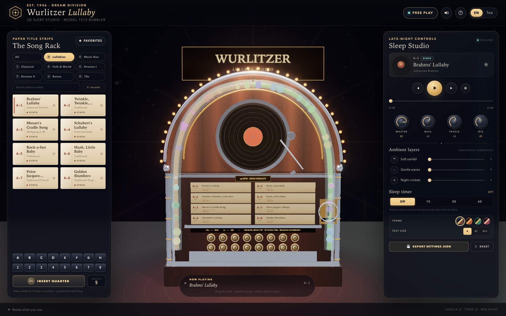
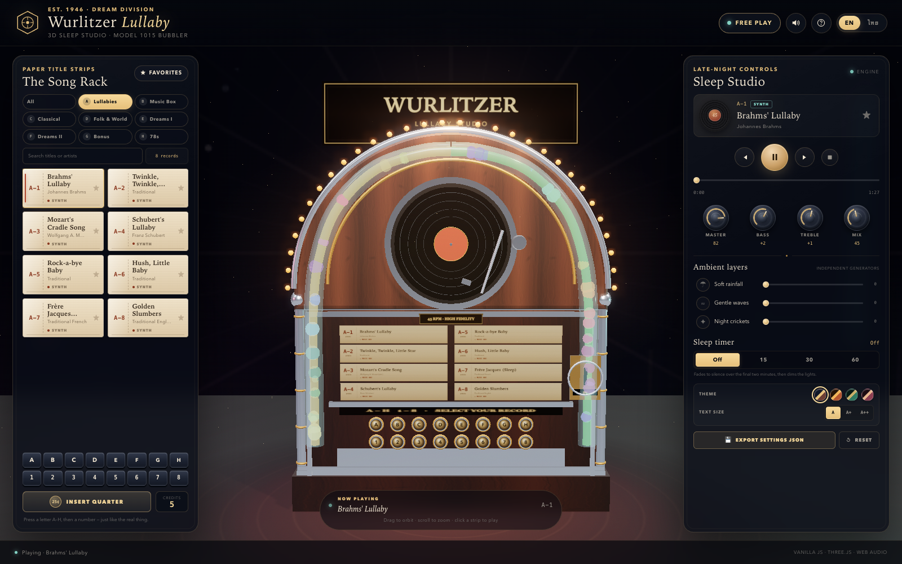
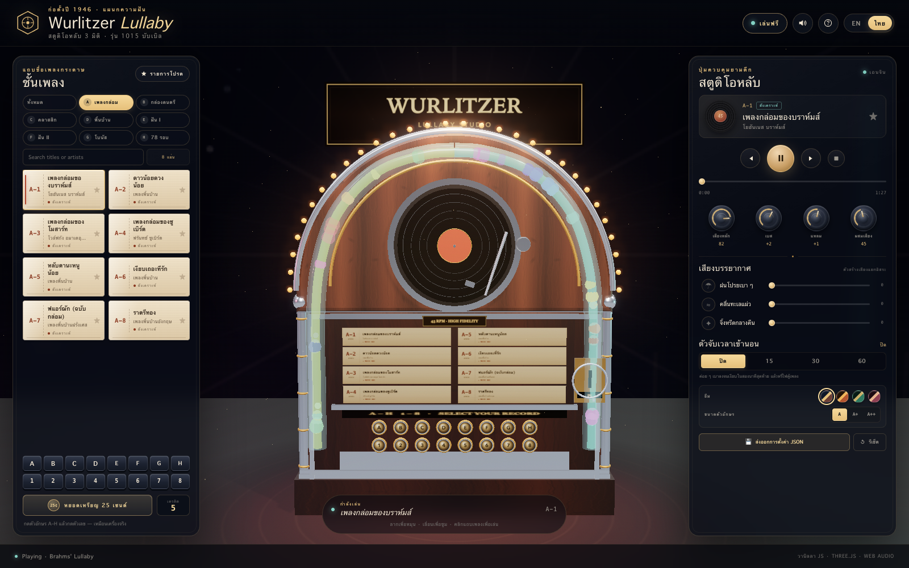
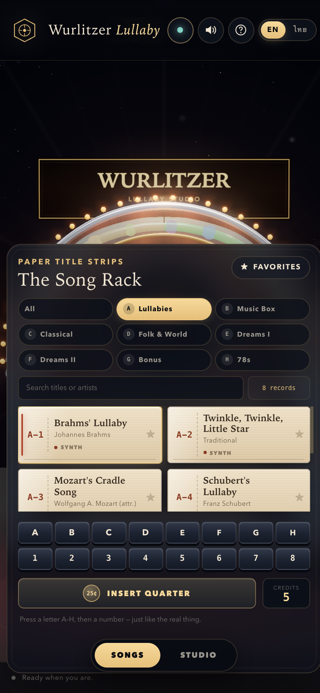
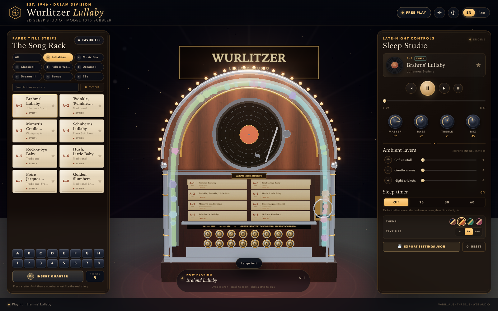
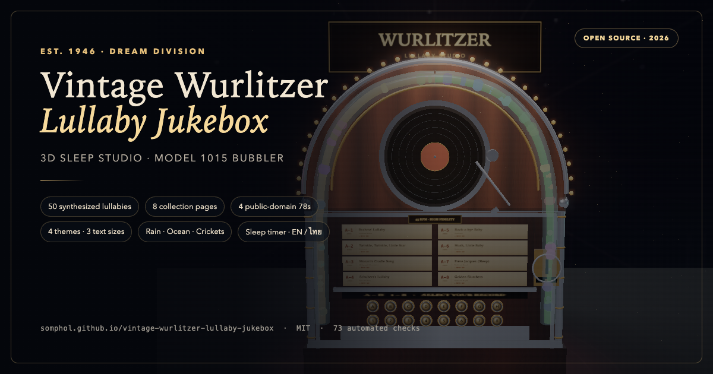

# Vintage Wurlitzer 3D Lullaby Jukebox & Sleep Studio

**A glowing 1940s Wurlitzer 1015 “Bubbler”, rebuilt as a browser-based sleep instrument.**
Insert a quarter, pick a paper title strip, and let fifty procedurally synthesized music-box
lullabies — or four vintage 78 RPM archive recordings — play you to sleep under rain, waves and
crickets.

[**Open the live jukebox →**](https://somphol.github.io/vintage-wurlitzer-lullaby-jukebox/)

[](CHANGELOG.md)
[](LICENSE)
[](https://threejs.org/)
[](#quick-start)
[](#bilingual-interface)



---

## What it is

A complete, static, client-side 3D web application. There is no backend, account system, build
step, package manager or analytics. The deployed artifact is this repository served from GitHub
Pages.

The cabinet is modelled procedurally in Three.js: walnut grain, chrome trim, a lit arch, rising
bubble tubes, a spinning 45 RPM record, a moving tone arm, a paper title rack and a mechanical
A–H / 1–8 keypad.

**New to the repository?** Start with [AGENTS.md](AGENTS.md) for the fast handoff, then
[docs/REPRODUCTION.md](docs/REPRODUCTION.md) for a from-zero rebuild. Audio is generated live with the Web Audio API, or streamed from a validated JSON
manifest of CORS-enabled, public-domain archive recordings.

| | |
| --- | --- |
| **Live** | <https://somphol.github.io/vintage-wurlitzer-lullaby-jukebox/> |
| **Source** | <https://github.com/somphol/vintage-wurlitzer-lullaby-jukebox> |
| **Stack** | Vanilla HTML5, CSS3, ES2022 modules, Three.js 0.169.0 (CDN import map) |
| **Audio** | Web Audio API — oscillators, convolution reverb, noise generators, EQ |
| **Persistence** | `localStorage`, plus JSON export |
| **Tests** | 11 engine checks, 12 repository checks, 25 in-page checks, 25 headless-browser checks |
| **License** | MIT (code); recordings keep their own licences — see [THIRD_PARTY_NOTICES.md](THIRD_PARTY_NOTICES.md) |

---

## Screenshots

| Playing a lullaby | ภาษาไทย |
| --- | --- |
|  |  |

| Mobile | Amber Lounge · large text |
| --- | --- |
|  |  |



---

## Features

### The cabinet

- **Wurlitzer 1015 silhouette** — extruded walnut arch, chrome pilasters, brass inlays, arched glass.
- **Liquid bubble tubes** — 44 translucent bubbles travel Catmull-Rom curves up both sides of the
  arch, shifting hue while the music plays.
- **30 warm marquee bulbs** around the arch that pulse with the audio envelope.
- **Visible 45 RPM mechanism** — platter, grooved vinyl, red label, spindle and animated tone arm.
- **Paper title strips** rendered as real textures in the 3D rack (the active eight-record page),
  plus a 64-slot DOM rack with category tabs, search and favourites.
- **Mechanical A–H / 1–8 keypad** with 3D key travel, synthesized clack, arm/play animation and
  authentic “empty slot” rejection.
- **Coin slot** — a quarter physically drops into the chrome slot; Free Play is the default.
- **Orbit camera** with constrained angles, cinematic intro and a reduced-motion path.

### Dual-engine audio

- **Engine 1 — procedural music box.** A look-ahead step sequencer with triangle/sine oscillators,
  per-note gain envelopes, octave sparkle harmonics and convolution reverb. Fifty public-domain /
  original lullabies across eight collections, no network required.
- **Engine 2 — archive stream loader.** `data/playlist.json` is validated (https only, C-1…H-8,
  unique slots, duration, licence, credit) and played through a `MediaElementAudioSourceNode`.
  Four public-domain 78 RPM / early recordings from Wikimedia Commons.
- **Ambient mixer** — three independent noise generators:
  - soft rainfall (filtered white noise + random droplets),
  - gentle ocean waves (brown noise + slow surf LFO),
  - night crickets (band-passed noise bed + chirp bursts).
- **Master chain** — music bus → low-shelf EQ → high-shelf EQ → compressor → master → sleep-timer
  gain → analyser → destination.
- **Sleep timer** — 15 / 30 / 60 minutes; smoothstep fade across the final two minutes, then the
  cabinet lights dim and all sources stop.

### Interface

- **Bilingual EN ⇄ TH** — every static label, title strip, artist, status message, help step and
  timer string updates instantly; the 3D paper textures are redrawn too.
- **Category tabs and search** — eight collection pages (Lullabies, Music Box, Classical,
  Folk & World, Dreams I/II, Bonus, 78s), 64 rack slots and instant title/artist search.
- **Themes and text size** — Midnight, Amber Lounge, Emerald Club and Rose Salon palettes, plus
  A / A+ / A++ text sizing; both persist and the theme reaches the 3D lights.
- **Art-deco HUD** — walnut-and-brass palette, four rotary knobs, live progress, transport,
  favourites filter, credits counter and keyboard shortcuts.
- **Persistence** — language, free-play mode, credits, favourites, volumes, EQ, ambient mix,
  timer preference, last record, theme and text size survive reloads.
- **Export** — `💾 Export settings JSON` downloads the full settings and track manifest.
- **Accessibility** — semantic buttons, ARIA slider knobs, visible focus rings, skip link, reduced
  motion, keyboard operation and a screen-reader live status.
- **Diagnostics** — open `?selftest` for 25 in-page checks rendered as a pass/fail list.

---

## Quick start

No install, no build.

```bash
# Any static server works; fetch() needs http(s), not file://
python3 -m http.server 8000
# open http://localhost:8000/
```

The page loads Three.js from jsDelivr, so the first visit needs network access. After that the
browser cache usually serves the module. The procedural lullabies themselves use zero bandwidth.

```bash
# Tests
node --test tests/engine.test.mjs tests/static.test.mjs
node tests/browser.test.mjs                 # headless Chrome, mock keychain
TEST_URL=https://somphol.github.io/vintage-wurlitzer-lullaby-jukebox/ \
  node tests/browser.test.mjs               # live suite

# Diagnostics
open http://localhost:8000/?selftest
```

See [docs/TESTING.md](docs/TESTING.md) for the harness, expected counts and troubleshooting.

---

## Controls

| Action | Mouse / touch | Keyboard |
| --- | --- | --- |
| Play a record | Click a title strip, or a 3D strip | `Enter` / `Space` on a strip, or `Space` to play |
| Mechanical select | Press `A`–`D`, then `1`–`8` | Same keys on the on-screen keypad |
| Play / pause | Gold transport button | `Space` |
| Previous / next | Transport arrows | `←` / `→` |
| Stop | Square button | — |
| Language | EN / ไทย switch | `L` |
| Timer | Off / 15 / 30 / 60 | `T` cycles |
| Mute | Speaker icon | `M` |
| Free Play | Top-bar chip | `F` |
| Knobs | Drag vertically or scroll | Focus, then arrows / `Home` / `End` |
| Orbit | Drag the stage; scroll to zoom | — |
| Help | `?` icon | `Esc` closes |

**Coin mode:** turn Free Play off, then press **Insert quarter**. Each selection costs one credit.
The 3D coin drop is only cosmetic; credits are persisted.

---

## Track catalogue

Fifty synthesized records across eight collection pages, plus four public-domain archive streams.
The full slot-by-slot catalogue is in [docs/TRACKS.md](docs/TRACKS.md).

| Page | Collection | Records | Character |
| --- | --- | ---: | --- |
| A | Lullabies | 8 | Brahms, Twinkle, Mozart, Schubert and folk lullabies |
| B | Music Box | 8 | All Through the Night, Au Clair de la Lune, Grieg, Schumann |
| C | Classical | 8 | Beethoven, Mozart, Pachelbel, Bach, Debussy, Satie |
| D | Folk & World | 8 | Sakura, Arirang, Mo Li Hua, Greensleeves, Danny Boy |
| E | Dreams I | 8 | Original velvet-hour instrumentals |
| F | Dreams II | 8 | Original snowfall / harbor / glass-garden pieces |
| G | Bonus | 2 | Amazing Grace, Down by the Salley Gardens |
| H | 78s | 4 | Public-domain archive recordings |

All fifty synth tracks are original arrangements of public-domain melodies or original compositions.
The four archive recordings are marked **Public domain** on their Wikimedia Commons pages. No audio
file is committed; the manifest holds URLs only. See [docs/TRACKS.md](docs/TRACKS.md) for the full
table and [THIRD_PARTY_NOTICES.md](THIRD_PARTY_NOTICES.md) for provenance.

### Royalty-free guarantee

Every audible track in 1.1.0 is royalty-free:

- **50 synth tracks** — either a public-domain melody in an original arrangement, or an original
  composition by Wurlitzer Dream Division. Each track carries a `rights` field
  (`public-domain` / `original`), checked by the engine test.
- **4 archive tracks** — public-domain recordings only. The manifest validator and the static test
  require `license: "Public domain"`; no CC BY-SA, attribution-only, or copyrighted recording is
  shipped.
- **Ambient beds** — synthesized noise and chirps, no samples.
- **No lyrics, samples or audio files** are redistributed; the archive manifest contains URLs only.

---

## Architecture

```
index.html          shell, HUD, import map (Three 0.169.0), JSON-LD, modals
style.css           art-deco design system, responsive drawers, reduced motion
script.js           I18N → pure engine → tracks → audio → Three.js → app/self-test
data/playlist.json  validated external archive manifest (C-1…C-4)
tests/              engine + static (Node) and browser (CDP) suites
scripts/            screenshot and social-card generation
docs/               architecture, reproduction, audio, design, ops and policy
```

Inside `script.js`:

1. **`/* I18N:START */`** — EN/TH dictionaries, kept symmetrical by tests.
2. **`/* ENGINE:START */`** — pure functions: note maths, sequence parsing, fade curve, slots,
   rack building, settings normalisation, manifest validation, export payload. No DOM, no network,
   no `Date`, no Three.js, loadable in Node.
3. **Track catalogue** — fifty note arrays across eight collections, parsed once into MIDI/frequency/beats.
4. **`JukeboxAudio`** — graph builder, look-ahead synth scheduler, stream element, ambient
   generators, timer loop, analyser level.
5. **`WurlitzerScene`** — renderer, PMREM environment, procedural textures, cabinet assembly,
   bubble animation, raycasting, bloom composer.
6. **`WurlitzerApp`** — UI bindings, persistence, language, coins, favourites, timer, diagnostics.

Deep dives: [ARCHITECTURE](docs/ARCHITECTURE.md) · [AUDIO](docs/AUDIO.md) ·
[DESIGN](docs/DESIGN.md) · [DECISIONS](docs/DECISIONS.md).

---

## Verification

```bash
node --test tests/engine.test.mjs tests/static.test.mjs   # 23 checks
node tests/browser.test.mjs                              # 25 checks + 25 in-page
```

The browser suite launches **one** headless Chrome with `--use-mock-keychain` and a temporary
profile. That flag is deliberate: it prevents repeated macOS Keychain prompts. It serves the
repository on an ephemeral port; no credentials or accounts are touched. Set `CHROME` if Chrome is
not at the macOS default path.

The live suite is the same command with `TEST_URL`. The 1.1.0 release passed 11 engine, 12 static,
25 in-page and 25 browser checks with **zero console errors**.

---

## Deployment

```bash
git push origin main
```

GitHub Pages serves `main` / root at
<https://somphol.github.io/vintage-wurlitzer-lullaby-jukebox/>. `.nojekyll` keeps underscore paths
intact. No environment variables, secrets or build artefacts are required. See
[docs/DEPLOYMENT.md](docs/DEPLOYMENT.md) for the API recipe, cache notes and rollback.

---

## Privacy, accessibility & performance

- **Privacy:** no analytics, cookies, accounts, uploads or third-party scripts beyond the Three.js
  CDN. Settings live only in `localStorage`. Archive audio is fetched directly from Wikimedia.
- **Accessibility:** keyboard-complete, ARIA-labelled controls, visible focus, skip link, reduced
  motion, contrast-checked palette and a live status region.
- **Performance:** capped DPR (2), half-resolution bloom, 30-frame-friendly geometry, a single
  visible cabinet and a paused render loop is avoided only when the tab is hidden by the browser.
  Mobile opens the song rack and studio as bottom sheets.

Details: [ACCESSIBILITY](docs/ACCESSIBILITY.md) · [PERFORMANCE](docs/PERFORMANCE.md) ·
[PRIVACY](docs/PRIVACY.md).

---

## Credits

Built in a single **OpenCode** session with **DeepSeek V4.1 Flash**
(`opencode-go/deepseek-v4.1-flash`): **29m 59s** and **16.3M tokens** (cache reads dominate) at the
time of capture. Exact counters, file inventory and verification live in [state.json](state.json).
Three.js 0.169.0 (MIT). The fifty synthesized arrangements are public-domain melodies or original
compositions; the four archive recordings are public domain and individually credited in
[THIRD_PARTY_NOTICES.md](THIRD_PARTY_NOTICES.md). The build-session record, including elapsed time
and token usage, is in [state.json](state.json). Full credits: [docs/CREDITS.md](docs/CREDITS.md).

---

## License & disclaimer

Code and original assets: **MIT** — see [LICENSE](LICENSE). Recordings retain their source licences.
This is a fan-made visual tribute, not affiliated with Wurlitzer, Gibson or any rights holder.
It is a relaxation toy, not a medical device; do not use it to diagnose or treat sleep disorders.
